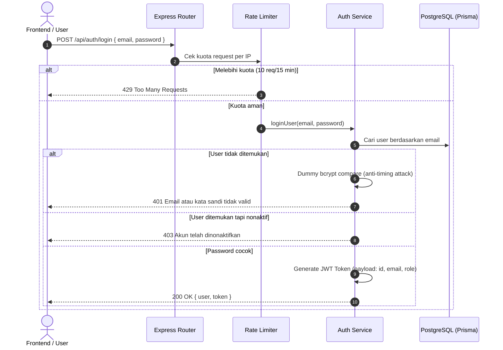

# Dokumentasi Arsitektur & Spesifikasi Fitur Autentikasi

Dokumen ini mendefinisikan arsitektur, spesifikasi teknis, mekanisme keamanan, dan panduan integrasi sistem Autentikasi dan Otorisasi (RBAC) pada backend H5P Content Generator.

---

## 1. Ringkasan & Arsitektur Sistem

Sistem autentikasi dibangun menggunakan pola **Token-Based Authentication (JWT)** dengan standar keamanan industri:
* **Metode Login**: Email & Password *(sudah aktif)* serta Google OAuth 2.0 *(spesifikasi siap integrasi)*.
* **Model Hak Akses (RBAC)**:
  * `USER`: Pembuat konten (dapat mengunggah materi, mengedit di Studio, dan mengekspor paket .h5p).
  * `ADMIN`: Administrator sistem (**khusus untuk mengelola pengguna**: melihat daftar user, mengubah role, mengaktifkan/menonaktifkan akun, dan menghapus akun).
* **Lapisan Keamanan**:
  * Bcrypt password hashing (Cost factor 12).
  * Rate Limiting brute-force pada endpoint autentikasi (maksimal 10 request / 15 menit).
  * Perlindungan Timing Attack saat validasi password.
  * Sanitasi data respons (hash password tidak pernah diekspos ke klien).

### Diagram Alur Autentikasi (JWT)



---

## 2. Fitur 1: Autentikasi Email & Kata Sandi (Implementasi Saat Ini)

### A. Format & Validasi Input
* **Email**:
  * Harus berformat valid (standar RFC 5322).
  * Dibersihkan (*trimmed*) dan diubah ke huruf kecil (*lowercase*) sebelum disimpan / dicek.
* **Kata Sandi**:
  * Minimal **8 karakter**.
  * Wajib memuat kombinasi **huruf dan angka** (`/[A-Za-z]/` dan `/[0-9]/`).
  * Di-hash menggunakan library `bcryptjs` dengan salt round 12.

### B. Endpoint Autentikasi

#### 1. Registrasi Akun Baru
* **Endpoint**: `POST /api/auth/register`
* **Proteksi**: `authRateLimiter` (10 request / 15 menit)
* **Request Body**:
  ```json
  {
    "email": "guru@sekolah.sch.id",
    "password": "Password123!",
    "name": "Budi Santoso"
  }
  ```
* **Response (201 Created)**:
  ```json
  {
    "message": "Pendaftaran akun berhasil.",
    "data": {
      "user": {
        "id": "e93f9409-f529-4d23-b1d5-bc75143a4111",
        "email": "guru@sekolah.sch.id",
        "name": "Budi Santoso",
        "role": "USER",
        "isActive": true,
        "avatarUrl": null,
        "createdAt": "2026-11-10T06:50:00.000Z",
        "updatedAt": "2026-11-10T06:50:00.000Z"
      },
      "token": "eyJhbGciOiJIUzI1NiIsInR5cCI6IkpXVCJ9..."
    }
  }
  ```

#### 2. Masuk ke Sistem (Login)
* **Endpoint**: `POST /api/auth/login`
* **Proteksi**: `authRateLimiter` (10 request / 15 menit) + Timing Attack Mitigation
* **Request Body**:
  ```json
  {
    "email": "guru@sekolah.sch.id",
    "password": "Password123!"
  }
  ```
* **Response (200 OK)**:
  ```json
  {
    "message": "Berhasil masuk ke sistem.",
    "data": {
      "user": {
        "id": "e93f9409-f529-4d23-b1d5-bc75143a4111",
        "email": "guru@sekolah.sch.id",
        "name": "Budi Santoso",
        "role": "USER",
        "isActive": true,
        "avatarUrl": null,
        "createdAt": "2026-11-10T06:50:00.000Z",
        "updatedAt": "2026-11-10T06:50:00.000Z"
      },
      "token": "eyJhbGciOiJIUzI1NiIsInR5cCI6IkpXVCJ9..."
    }
  }
  ```

#### 3. Cek Profil Pengguna Aktif
* **Endpoint**: `GET /api/auth/me`
* **Header Wajib**: `Authorization: Bearer <token>`
* **Response (200 OK)**:
  ```json
  {
    "data": {
      "id": "e93f9409-f529-4d23-b1d5-bc75143a4111",
      "email": "guru@sekolah.sch.id",
      "name": "Budi Santoso",
      "role": "USER",
      "isActive": true,
      "avatarUrl": null,
      "createdAt": "2026-11-10T06:50:00.000Z",
      "updatedAt": "2026-11-10T06:50:00.000Z"
    }
  }
  ```

### C. Akun Bawaan (Default Seeder)
Sistem secara otomatis menginisialisasi dua akun awal ketika server pertama kali dijalankan:
1. **Akun Administrator**:
   * Email: `admin@h5p.local`
   * Password: `Admin1234!`
   * Role: `ADMIN`
2. **Akun Pengguna Biasa**:
   * Email: `user@h5p.local`
   * Password: `User1234!`
   * Role: `USER`

*(Endpoint inisialisasi manual tersedia di `POST /api/auth/seed`).*

---

## 3. Fitur 2: Google OAuth 2.0 (Spesifikasi & Roadmap Integrasi)

Fitur Google Auth dirancang menggunakan alur modern **Google Identity Services (GIS)** berbasis ID Token (JWT Google).

### Alur Kerja (GIS Flow):
1. **Frontend**: Pengguna menekan tombol *"Sign in with Google"*. Google One-Tap SDK mengembalikan `credential` (ID Token yang ditandatangani Google).
2. **Frontend -> Backend**: Mengirimkan ID Token ke `POST /api/auth/google`.
3. **Backend Verifikasi**:
   * Memvalidasi token ke Google API (`https://oauth2.googleapis.com/tokeninfo?id_token=...` atau via `google-auth-library`).
   * Mengambil `sub` (Google ID unik), `email`, `name`, dan `picture`.
4. **Sinkronisasi Akun**:
   * Jika user dengan `googleId` sudah ada -> Langsung buat sesi JWT.
   * Jika user dengan `email` sudah ada (sebelumnya daftar via password) -> Tautkan `googleId` ke akun tersebut (*account linking*).
   * Jika belum ada sama sekali -> Buat user baru dengan `role: "USER"`.

### Skema Kontrak API Google Auth:
* **Endpoint**: `POST /api/auth/google`
* **Request**:
  ```json
  {
    "idToken": "eyJhbGciOiJSUzI1NiIsImtpZCI6IjEy..."
  }
  ```
* **Respons**: Mengembalikan objek `user` dan `token` JWT lokal (format identik dengan respons login biasa).

---

## 4. Fitur 3: Rate Limiting & Proteksi Keamanan

| Vektor Serangan | Mekanisme Pertahanan | Implementasi |
| :--- | :--- | :--- |
| **Brute Force & Credential Stuffing** | Pembatasan frekuensi request per alamat IP | `authRateLimiter` (10 request per 15 menit) di [`src/middleware/rateLimiter.ts`](file:///C:/Users/Indra/Documents/Documents/Semester%207/H5P-Content-Generator/backend/src/middleware/rateLimiter.ts). |
| **Timing Attacks (User Enumeration)** | Menyamakan waktu eksekusi hash compare | Jika user tidak ditemukan, sistem tetap menjalankan `bcrypt.compare` dengan dummy hash agar respons waktu tidak membocorkan keberadaan email. |
| **Password Leakage** | Sanitasi objek model pada layer service | Fungsi `sanitizeUser` menghapus properti `passwordHash` sebelum dikembalikan ke router/klien. |
| **Penyalahgunaan Akun Dinonaktifkan** | Validasi status realtime di middleware | Middleware `authenticateToken` mengecek status `isActive`. Jika akun dinonaktifkan oleh Admin, token langsung ditolak dengan status HTTP 403. |
| **SQL Injection** | Parameterized Queries | Menggunakan Prisma ORM yang secara otomatis membungkus parameter ke prepared statements PostgreSQL. |
| **Data Payload Flooding** | Batas ukuran body parser Express | `express.json({ limit: "50mb" })` untuk mendukung ekspor/impor presentasi besar tanpa buffer overflow. |

---

## 5. Fitur 4: Role Admin & Manajemen Pengguna (User Management)

Hak akses `ADMIN` dirancang secara spesifik **hanya untuk mengelola akun pengguna**:
* Memeriksa seluruh pengguna yang terdaftar di platform.
* Mengubah peran pengguna (menjadikan pengguna lain sebagai Admin atau sebaliknya).
* Memblokir (*suspend*) akses pengguna yang melanggar aturan tanpa menghapus data materinya.
* Menghapus akun pengguna yang tidak aktif.

### Aturan Keamanan Khusus Admin:
1. **Perlindungan Akun Sendiri**: Admin tidak dapat menghapus akunnya sendiri melalui endpoint ini.
2. **Perlindungan Hak Akses Tunggal**: Admin tidak dapat mencopot status admin dirinya sendiri jika sedang login.

### API Manajemen Pengguna (Prefix: `/api/admin`):
*Seluruh endpoint di bawah ini wajib menyertakan header `Authorization: Bearer <token>` milik pengguna dengan role `ADMIN`.*

#### 1. Daftar Pengguna (List Users)
* **Endpoint**: `GET /api/admin/users?q=budi&role=USER&page=1&limit=20`
* **Parameter Query**:
  * `q` *(opsional)*: Kata kunci pencarian berdasarkan nama atau email.
  * `role` *(opsional)*: Filter role (`ADMIN` atau `USER`).
  * `page` *(opsional)*: Halaman data (default: 1).
  * `limit` *(opsional)*: Jumlah per halaman (default: 20, maks: 100).
* **Response (200 OK)**:
  ```json
  {
    "data": [
      {
        "id": "e93f9409-f529-4d23-b1d5-bc75143a4111",
        "email": "guru@sekolah.sch.id",
        "name": "Budi Santoso",
        "role": "USER",
        "isActive": true,
        "avatarUrl": null,
        "projectsCount": 5,
        "createdAt": "2026-11-10T06:50:00.000Z",
        "updatedAt": "2026-11-10T06:50:00.000Z"
      }
    ],
    "pagination": {
      "total": 1,
      "page": 1,
      "limit": 20,
      "totalPages": 1
    }
  }
  ```

#### 2. Detail Pengguna
* **Endpoint**: `GET /api/admin/users/:id`
* **Response (200 OK)**: Mengembalikan profil lengkap user beserta jumlah proyek materi yang dimiliki.

#### 3. Ubah Role Pengguna
* **Endpoint**: `PATCH /api/admin/users/:id/role`
* **Request Body**:
  ```json
  { "role": "ADMIN" }
  ```
* **Response (200 OK)**: Mengembalikan data user dengan role baru.

#### 4. Aktifkan / Nonaktifkan Pengguna (Blokir Akun)
* **Endpoint**: `PATCH /api/admin/users/:id/status`
* **Request Body**:
  ```json
  { "isActive": false }
  ```
* **Response (200 OK)**: Mengembalikan data user dengan status `isActive: false`.

#### 5. Hapus Pengguna
* **Endpoint**: `DELETE /api/admin/users/:id`
* **Response (204 No Content)**.

---

## 6. Verifikasi & Pengujian Otomatis

Seluruh logika bisnis autentikasi telah diuji secara otomatis dan dapat dijalankan kapan saja dengan perintah:
```bash
npm run test:auth
```

Output pengujian:
```text
=== MEMULAI TEST UNIT FITUR AUTENTIKASI ===
✓ Test 1 Lolos: Bcrypt hashing & verification bekerja dengan benar.
✓ Test 2 Lolos: Sanitasi dan validasi format email bekerja akurat.
✓ Test 3 Lolos: Validasi kompleksitas password berhasil menolak password lemah.
✓ Test 4 Lolos: JWT Token generation, signing, and verification bekerja aman.
✓ Test 5 Lolos: Sanitasi objek user tidak membocorkan hash password.
==============================================
SEMUA 5 SKENARIO TEST AUTENTIKASI BERHASIL!
==============================================
```
