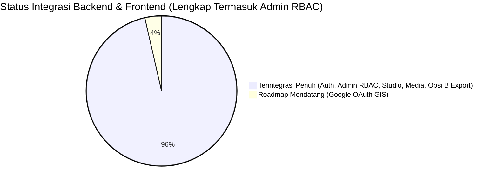

# Matriks Status Integrasi Backend ke Frontend

Dokumen ini memetakan seluruh status kesiapan integrasi antara **Backend** dan **Frontend** pada proyek **H5P Content Generator**, menguraikan fitur apa saja yang **sudah selesai terintegrasi**, **sudah siap di backend tetapi belum disambungkan ke frontend**, serta **yang masih dalam rencana (belum dikerjakan)**.

---

## 1. Modul Autentikasi & Akun Pengguna

| Fitur / Komponen | Endpoint Backend | Status Backend | Status Frontend | Status Integrasi | Keterangan & Catatan |
| :--- | :--- | :---: | :---: | :---: | :--- |
| **Pendaftaran (Register)** | `POST /api/auth/register` | ✅ Selesai | ✅ Helper Siap | ✅ **Terintegrasi** | Backend mewajibkan `@gmail.com`, password min 8–128 char (huruf+angka), role dikunci `USER`, bcrypt cost 12, rate limiter 10 req/15 menit. Service frontend `registerWithEmail` tersedia di [`authService.ts`](file:///C:/Users/Indra/Documents/Documents/Semester%207/H5P-Content-Generator/frontend/src/services/authService.ts). |
| **Masuk (Login Email & Password)** | `POST /api/auth/login` | ✅ Selesai | ✅ Selesai | ✅ **Terintegrasi Penuh** | [`LoginPage.tsx`](file:///C:/Users/Indra/Documents/Documents/Semester%207/H5P-Content-Generator/frontend/src/pages/LoginPage.tsx) terhubung ke `POST /api/auth/login` (wajib `@gmail.com`), dengan proteksi Timing Attack (`TIMING_DUMMY_HASH`), `HS256` algorithm pinning, dan rate limiting. |
| **Cek Profil Pengguna (`/me`)** | `GET /api/auth/me` | ✅ Selesai | ✅ Selesai | ✅ **Terintegrasi Penuh** | [`AuthContext.tsx`](file:///C:/Users/Indra/Documents/Documents/Semester%207/H5P-Content-Generator/frontend/src/context/AuthContext.tsx) memvalidasi token aktif ke `/api/auth/me` saat aplikasi dimuat dan menolak sesi akun yang dinonaktifkan (`401`/`403`). |
| **Inisialisasi Akun Bawaan (Seeder)** | `POST /api/auth/seed` | ✅ Selesai | ➖ N/A | ✅ **Selesai** | Akun default `@gmail.com`: `admin.h5p@gmail.com` (`ADMIN`) & `user.h5p@gmail.com` (`USER`). Endpoint `/seed` otomatis diblokir (`403`) di production. |
| **Google OAuth 2.0 Login** | `POST /api/auth/google` | ⏳ Desain Siap | ⏳ Placeholder | ❌ **Belum Dikerjakan** | Spesifikasi GIS ID Token terdokumentasi di `AUTHENTICATION.md`. Tombol Google di `LoginPage.tsx` masih nonaktif menunggu `GOOGLE_CLIENT_ID`. |
| **Auth State, Route Guard & Logout** | ➖ N/A | ➖ N/A | ✅ Selesai | ✅ **Terintegrasi Penuh** | Rute `/dashboard`, `/materi`, dan `/studio` dibungkus [`ProtectedRoute`](file:///C:/Users/Indra/Documents/Documents/Semester%207/H5P-Content-Generator/frontend/src/App.tsx). Cache `localStorage` & `sessionStorage` diisolasi per `userId` dan dibersihkan saat klik **Keluar**. |
| **Auth Token Interceptor & Download** | ➖ N/A | ➖ N/A | ✅ Selesai | ✅ **Terintegrasi Penuh** | [`api.ts`](file:///C:/Users/Indra/Documents/Documents/Semester%207/H5P-Content-Generator/frontend/src/services/api.ts) & [`apiUpload.ts`](file:///C:/Users/Indra/Documents/Documents/Semester%207/H5P-Content-Generator/frontend/src/services/apiUpload.ts) otomatis menyisipkan `Authorization: Bearer <token>`, menangani HTTP `401`, serta menyediakan `apiDownload()` untuk ekspor `.h5p`. |

---

## 2. Modul Otorisasi & Manajemen Pengguna (Admin RBAC)

| Fitur / Komponen | Endpoint Backend | Status Backend | Status Frontend | Status Integrasi | Keterangan & Catatan |
| :--- | :--- | :---: | :---: | :---: | :--- |
| **Daftar Seluruh Pengguna** | `GET /api/admin/users` | ✅ Selesai | ✅ Selesai | ✅ **Terintegrasi Penuh** | Mendukung pencarian (`q` maks 100 char), filter `role` (`ADMIN`/`USER`), filter `status` (`ACTIVE`/`BLOCKED`), paginasi, serta ringkasan global `summary` (`totalUsers`, `activeUsers`, `adminCount`). |
| **Detail Pengguna** | `GET /api/admin/users/:id` | ✅ Selesai | ➖ Opsional | ✅ **Siap di Backend** | Validasi UUID v1–v5, mengembalikan profil user + jumlah proyek (`ADMIN` only). |
| **Ubah Peran (Role) User** | `PATCH /api/admin/users/:id/role` | ✅ Selesai | ✅ Selesai | ✅ **Terintegrasi Penuh** | Tombol **Jadikan Admin / Jadikan Pengguna** di [`AdminUsersPage.tsx`](file:///C:/Users/Indra/Documents/Documents/Semester%207/H5P-Content-Generator/frontend/src/pages/admin/AdminUsersPage.tsx) dengan dialog konfirmasi dan pencegahan ubah peran diri sendiri. |
| **Blokir / Buka Blokir User** | `PATCH /api/admin/users/:id/status` | ✅ Selesai | ✅ Selesai | ✅ **Terintegrasi Penuh** | Validasi boolean ketat `isActive`; akun nonaktif langsung ditolak (`403`) di middleware auth & dicegah memblokir diri sendiri. |
| **Hapus Akun Pengguna** | `DELETE /api/admin/users/:id` | ✅ Selesai | ✅ Selesai | ✅ **Terintegrasi Penuh** | Menghapus akun dengan wajib ketik ulang email konfirmasi + pencegahan hapus diri sendiri. |
| **Halaman Admin Panel & Akses Silang** | ➖ N/A | ➖ N/A | ✅ Selesai | ✅ **Terintegrasi Penuh** | Rute `/admin/users` (`ProtectedRoute adminOnly`) memakai UI [`AdminLayout.tsx`](file:///C:/Users/Indra/Documents/Documents/Semester%207/H5P-Content-Generator/frontend/src/pages/admin/AdminLayout.tsx); Admin diarahkan ke `/admin/users` saat login dan bebas beralih ke `/dashboard`, `/materi`, `/studio` lewat menu sidebar. |

---

## 3. Modul Ingest & Konversi Dokumen (PPTX / PDF)

| Fitur / Komponen | Endpoint Backend | Status Backend | Status Frontend | Status Integrasi | Keterangan & Catatan |
| :--- | :--- | :---: | :---: | :---: | :--- |
| **Upload Dokumen Sumber** | `POST /api/projects/ingest` | ✅ Selesai | ✅ Selesai | ✅ **Terintegrasi Penuh** | Memerlukan `Authorization: Bearer <token>`, mengikat proyek ke `req.user.id`, mengembalikan UUID proyek + ID job, dan `StudioView.tsx` langsung mengadopsi UUID proyek lewat `adoptProject()`. |
| **Polling Status Konversi** | `GET /api/ingest-jobs/:id` | ✅ Selesai | ✅ Selesai | ✅ **Terintegrasi Penuh** | Endpoint terautentikasi + cek kepemilikan `job.project.userId === req.user.id`. Polling progres konversi (0–100%). |
| **Pengambilan Slide Hasil Konversi** | `GET /api/projects/:id/slides` | ✅ Selesai | ✅ Selesai | ✅ **Terintegrasi Penuh** | Dilindungi `authenticateToken` + `assertProjectOwner`, mengembalikan slide beserta seluruh properti `rotation` & `popupButton*`. |
| **Penyajian Aset Media & Background** | `GET /api/projects/:id/assets/:file` | ✅ Selesai | ✅ Selesai | ✅ **Terintegrasi Penuh** | Validasi UUID proyek & nama berkas aman, header `X-Content-Type-Options: nosniff`, `Cross-Origin-Resource-Policy: cross-origin`, dan `CSP sandbox` khusus SVG. |
| **Validasi Biner & Anti-File Palsu** | Middleware Upload Validator | ✅ Selesai | ✅ Selesai | ✅ **Terintegrasi Penuh** | Pengecekan Magic Bytes PDF/PPTX, penolakan berkas terenkripsi kata sandi, dan penolakan `.h5p`/media palsu. |
| **Deduplikasi Berkas (SHA-256)** | Middleware Upload Validator | ✅ Selesai | ✅ Selesai | ✅ **Terintegrasi Penuh** | Pengecekan duplikasi nama/hash SHA-256 terisolasi **per `userId`**, sehingga akun berbeda tetap dapat mengunggah materi yang sama. |
| **Fallback Konversi Lokal** | Browser Client-side Parser | ➖ N/A | ✅ Selesai | ✅ **Terintegrasi** | Aktif hanya ketika backend tidak terjangkau saat offline (tetap menolak error validasi 400/409/413/422 dari server). |

---

## 4. Modul Studio Editor & Penyimpanan Materi

| Fitur / Komponen | Endpoint Backend | Status Backend | Status Frontend | Status Integrasi | Keterangan & Catatan |
| :--- | :--- | :---: | :---: | :---: | :--- |
| **Upload Media Elemen Studio** | `POST /api/projects/:id/assets` | ✅ Selesai | ✅ Selesai | ✅ **Terintegrasi Penuh** | [`ElementContentFields.tsx`](file:///C:/Users/Indra/Documents/Documents/Semester%207/H5P-Content-Generator/frontend/src/features/studio/components/properties/ElementContentFields.tsx) mengunggah gambar/audio/video ke server dengan cek kepemilikan pra-Multer, validasi Magic Bytes, batas 10/50 MB, dan anti-XSS SVG. |
| **Simpan Slide, Judul & Pengaturan** | `PUT /api/projects/:id/slides` & `PATCH /api/projects/:id` | ✅ Selesai | ✅ Selesai | ✅ **Terintegrasi Penuh** | [`StudioContext.tsx`](file:///C:/Users/Indra/Documents/Documents/Semester%207/H5P-Content-Generator/frontend/src/context/StudioContext.tsx) `saveDraft()` menyinkronkan array slide (mempertahankan `rotation`, `popupButton*`, `No Zone`) sekaligus `title` & `settings` (`StorySettings`) ke PostgreSQL. |
| **Buat Materi Kosong & Impor `.h5p`** | `POST /api/projects` (+ `/assets` & `/slides`) | ✅ Selesai | ✅ Selesai | ✅ **Terintegrasi Penuh** | [`NewMaterialModal.tsx`](file:///C:/Users/Indra/Documents/Documents/Semester%207/H5P-Content-Generator/frontend/src/features/projects/components/NewMaterialModal.tsx) & [`ProjectsHome.tsx`](file:///C:/Users/Indra/Documents/Documents/Semester%207/H5P-Content-Generator/frontend/src/features/exporter/components/ProjectsHome.tsx) membuat proyek baru di PostgreSQL serta mengunggah aset hasil ekstraksi impor `.h5p`. |
| **Gandakan Materi (Duplicate)** | `POST /api/projects/:id/duplicate` | ✅ Selesai | ✅ Selesai | ✅ **Terintegrasi Penuh** | Menggandakan proyek, slide, serta folder aset di disk di bawah kepemilikan `req.user.id` melalui [`useProjectStore.ts`](file:///C:/Users/Indra/Documents/Documents/Semester%207/H5P-Content-Generator/frontend/src/features/projects/hooks/useProjectStore.ts). |
| **Sinkronisasi Daftar & Detail Materi** | `GET /api/projects` & `GET /api/projects/:id` | ✅ Selesai | ✅ Selesai | ✅ **Terintegrasi Penuh** | Filter ketat `where: { userId }`, proyek lama `userId: null` sudah dibersihkan, `fetchServerProject()` memulihkan `settingsJson` + `assetUrl` lengkap (termasuk path relatif `/api/...`). |
| **Ganti Nama & Hapus Materi** | `PATCH /api/projects/:id` & `DELETE /api/projects/:id` | ✅ Selesai | ✅ Selesai | ✅ **Terintegrasi Penuh** | Dilindungi `assertProjectOwner`, menghapus record DB beserta folder `storage/projects/<id>`. |

---

## 5. Modul Ekspor Paket & Pemutar Pratinjau H5P

| Fitur / Komponen | Endpoint Backend | Status Backend | Status Frontend | Status Integrasi | Keterangan & Catatan |
| :--- | :--- | :---: | :---: | :---: | :--- |
| **Laporan Pra-Ekspor (Checklist)** | `GET /api/projects/:id/export-report` | ✅ Selesai | ✅ Selesai | ✅ **Terintegrasi Penuh** | [`ExportStep.tsx`](file:///C:/Users/Indra/Documents/Documents/Semester%207/H5P-Content-Generator/frontend/src/features/exporter/components/ExportStep.tsx) menyinkronkan draf lalu memanggil `/export-report` (termasuk dukungan item pengecoh Drag & Drop `No Zone`). |
| **Ekspor Paket H5P Server (Opsi B)** | `POST /api/projects/:id/export` | ✅ Selesai | ✅ Selesai | ✅ **Terintegrasi Penuh** | Jalur utama melalui [`exportService.ts`](file:///C:/Users/Indra/Documents/Documents/Semester%207/H5P-Content-Generator/frontend/src/features/exporter/api/exportService.ts): menjalankan `saveDraft()` → mengunduh `.h5p` rakitan Lumi Server (termasuk rotasi, `popupButton*`, patch `H5P.CoursePresentation-1.26`). Fallback lokal aktif hanya untuk draf offline. |
| **Kompatibilitas Reader Luar (LMS)** | `fillSemanticsDefaults` | ✅ Selesai | ✅ Selesai | ✅ **Terintegrasi Penuh** | Pengisian otomatis semantik H5P di server (`contentMapper.ts`) & frontend (`elementMapper.ts`). |
| **Pratinjau Pemutar Server (Player)** | `POST /api/h5p/preview-sessions` & `/api/h5p/player/:id` | ✅ Selesai | ✅ Selesai | ✅ **Terintegrasi Penuh** | [`H5PServerPlayer.tsx`](file:///C:/Users/Indra/Documents/Documents/Semester%207/H5P-Content-Generator/frontend/src/features/preview/components/H5PServerPlayer.tsx) mengirim Bearer JWT + `projectId` (dicek IDOR di backend); `:sessionId` divalidasi UUID ketat anti-Reflected XSS. |
| **Pencatatan Riwayat Skor Siswa** | `GET /api/projects/:id/attempts` | ✅ Selesai | ✅ Selesai | ✅ **Terintegrasi Penuh** | `H5PServerPlayer.tsx` memuat & mem-poll skor percobaan langsung dari `/projects/:id/attempts` dengan autentikasi Bearer JWT. |

---

## 6. Rangkuman Status Integrasi Akhir

Seluruh jalur aplikasi — mulai dari **Login `@gmail.com` (JWT + `ProtectedRoute`)**, **Panel Admin RBAC (`/admin/users`: cari, filter peran/status, ubah peran, blokir/buka blokir, hapus) + Akses Silang Dashboard Materi**, **Isolasi Kepemilikan Proyek (`userId`)**, **Upload Dokumen & Media Studio (`POST /assets`)**, **Simpan Slide & Pengaturan (`PUT /slides` + `PATCH /settings`)**, **Buat Kosong / Impor `.h5p` / Duplikat**, **Player Server & Skor Attempts**, hingga **Ekspor `.h5p` Utama via Server Lumi (Opsi B)** — telah **terintegrasi penuh** dan terverifikasi.

> [!NOTE]
> * Google OAuth 2.0 (`POST /api/auth/google`) disiapkan sebagai pengembangan lanjutan setelah `GOOGLE_CLIENT_ID` tersedia.
