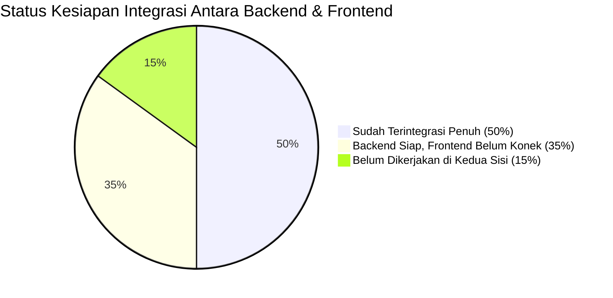

# Matriks Status Integrasi Backend ke Frontend

Dokumen ini memetakan seluruh status kesiapan integrasi antara **Backend** dan **Frontend** pada proyek **H5P Content Generator**, menguraikan fitur apa saja yang **sudah selesai terintegrasi**, **sudah siap di backend tetapi belum disambungkan ke frontend**, serta **yang masih dalam rencana (belum dikerjakan)**.

---

## 1. Modul Autentikasi & Akun Pengguna

| Fitur / Komponen | Endpoint Backend | Status Backend | Status Frontend | Status Integrasi | Keterangan & Catatan |
| :--- | :--- | :---: | :---: | :---: | :--- |
| **Pendaftaran (Register)** | `POST /api/auth/register` | ✅ Selesai | ❌ Belum Ada | ⏳ **Siap di Backend** | Backend sudah mendukung validasi email RFC 5322, password min 8 char (huruf+angka), bcrypt hashing (cost 12), dan rate limiting. Frontend belum memiliki halaman registrasi. |
| **Masuk (Login Email & Password)** | `POST /api/auth/login` | ✅ Selesai | ❌ Belum Ada | ⏳ **Siap di Backend** | Backend sudah memvalidasi password dengan salt unik, timing attack mitigation, pembatasan 10 percobaan/15 menit, dan menerbitkan JWT token. Frontend belum memiliki halaman form login. |
| **Cek Profil Pengguna (`/me`)** | `GET /api/auth/me` | ✅ Selesai | ❌ Belum Ada | ⏳ **Siap di Backend** | Mengembalikan data profil user berdasarkan `Authorization: Bearer <token>`. Frontend belum menyimpan token di LocalStorage/Cookie. |
| **Inisialisasi Akun Bawaan (Seeder)** | `POST /api/auth/seed` | ✅ Selesai | ➖ N/A | ✅ **Selesai** | Akun default `admin@h5p.local` dan `user@h5p.local` otomatis dibuat saat server backend pertama kali aktif. |
| **Google OAuth 2.0 Login** | `POST /api/auth/google` | ⏳ Desain Siap | ❌ Belum Ada | ❌ **Belum Dikerjakan** | Spesifikasi teknis (Google Identity Services GIS ID Token) sudah selesai dirancang di dokumen `AUTHENTICATION.md`. Menunggu pendaftaran `GOOGLE_CLIENT_ID` di Google Cloud Console. |
| **Auth State & Route Guard** | ➖ N/A | ➖ N/A | ❌ Belum Ada | ❌ **Belum Dikerjakan** | Frontend belum memiliki `AuthContext`, `useAuth`, maupun pembatas rute (*ProtectedRoute*). Pengguna saat ini langsung masuk ke Dashboard tanpa verifikasi login. |
| **Auth Token Interceptor** | ➖ N/A | ➖ N/A | ❌ Belum Ada | ❌ **Belum Dikerjakan** | File [`frontend/src/services/api.ts`](file:///C:/Users/Indra/Documents/Documents/Semester%207/H5P-Content-Generator/frontend/src/services/api.ts) belum menyematkan header `Authorization: Bearer <token>` pada setiap pemanggilan fetch. |

---

## 2. Modul Otorisasi & Manajemen Pengguna (Admin RBAC)

| Fitur / Komponen | Endpoint Backend | Status Backend | Status Frontend | Status Integrasi | Keterangan & Catatan |
| :--- | :--- | :---: | :---: | :---: | :--- |
| **Daftar Seluruh Pengguna** | `GET /api/admin/users` | ✅ Selesai | ❌ Belum Ada | ⏳ **Siap di Backend** | Mendukung pencarian (`q`), filter role (`ADMIN`/`USER`), paginasi data, dan menghitung total proyek materi per user. Khusus diakses oleh role ADMIN. |
| **Detail Pengguna** | `GET /api/admin/users/:id` | ✅ Selesai | ❌ Belum Ada | ⏳ **Siap di Backend** | Mengembalikan profil lengkap user dan riwayat proyek materi yang dibuat. |
| **Ubah Peran (Role) User** | `PATCH /api/admin/users/:id/role` | ✅ Selesai | ❌ Belum Ada | ⏳ **Siap di Backend** | Mengubah role user antara `USER` dan `ADMIN`. Dilengkapi validasi keamanan (admin tidak dapat mencopot hak akses dirinya sendiri). |
| **Blokir / Buka Blokir User** | `PATCH /api/admin/users/:id/status` | ✅ Selesai | ❌ Belum Ada | ⏳ **Siap di Backend** | Mengubah `isActive` (true/false). Jika user dinonaktifkan, seluruh token JWT miliknya otomatis ditolak (HTTP 403). |
| **Hapus Akun Pengguna** | `DELETE /api/admin/users/:id` | ✅ Selesai | ❌ Belum Ada | ⏳ **Siap di Backend** | Menghapus user secara permanen. Admin dicegah menghapus akunnya sendiri. |
| **Halaman Admin Panel (UI)** | ➖ N/A | ➖ N/A | ❌ Belum Ada | ❌ **Belum Dikerjakan** | Frontend belum memiliki halaman khusus Administrator (`/admin/users`) untuk mengelola tabel pengguna dan aksi blokir/role. |

---

## 3. Modul Ingest & Konversi Dokumen (PPTX / PDF)

| Fitur / Komponen | Endpoint Backend | Status Backend | Status Frontend | Status Integrasi | Keterangan & Catatan |
| :--- | :--- | :---: | :---: | :---: | :--- |
| **Upload Dokumen Sumber** | `POST /api/projects/ingest` | ✅ Selesai | ✅ Selesai | ✅ **Terintegrasi Penuh** | Frontend mengunggah PPTX/PDF via [`serverIngest.ts`](file:///C:/Users/Indra/Documents/Documents/Semester%207/H5P-Content-Generator/frontend/src/features/ingest/api/serverIngest.ts) dan backend mengembalikan ID Proyek serta ID Job konversi (HTTP 202). |
| **Polling Status Konversi** | `GET /api/ingest-jobs/:id` | ✅ Selesai | ✅ Selesai | ✅ **Terintegrasi Penuh** | Frontend melakukan polling berkala untuk memantau progres konversi (0–100%) dan status sukses/gagal. |
| **Pengambilan Slide Hasil Konversi** | `GET /api/projects/:id/slides` | ✅ Selesai | ✅ Selesai | ✅ **Terintegrasi Penuh** | Mengambil seluruh slide dan elemen hasil parsing materi dari backend untuk dimuat ke dalam kanvas Studio Editor. |
| **Penyajian Aset Media & Background** | `GET /api/projects/:id/assets/:file` | ✅ Selesai | ✅ Selesai | ✅ **Terintegrasi Penuh** | Gambar latar hasil render dan media yang diekstrak disajikan oleh backend dan ditampilkan langsung di frontend. |
| **Validasi Biner & Anti-File Palsu** | Middleware Upload Validator | ✅ Selesai | ✅ Selesai | ✅ **Terintegrasi Penuh** | Pengecekan magic bytes biner asli, penolakan file PDF/PPTX ber-password, dan deteksi error `ApiUploadError` di frontend. |
| **Deduplikasi Berkas (SHA-256)** | Middleware Upload Validator | ✅ Selesai | ⏳ Parsial | ⏳ **Perlu Penyelarasan** | Backend menolak file yang 100% identik dengan materi yang sudah ada (HTTP 409). Frontend sudah menangani pesan error 409 di modal upload. |
| **Fallback Konversi Lokal** | Browser Client-side Parser | ➖ N/A | ✅ Selesai | ✅ **Terintegrasi** | Jika server backend mati/tidak terjangkau, frontend otomatis beralih memproses PPTX/PDF langsung di browser pengguna. |

---

## 4. Modul Studio Editor & Penyimpanan Materi

| Fitur / Komponen | Endpoint Backend | Status Backend | Status Frontend | Status Integrasi | Keterangan & Catatan |
| :--- | :--- | :---: | :---: | :---: | :--- |
| **Simpan Slide dari Studio (Save)** | `PUT /api/projects/:id/slides` | ✅ Selesai | ❌ Belum Dipanggil | ⏳ **Siap di Backend** | Backend sudah memiliki endpoint `PUT` dan normalisasi path aset `assets/`. Frontend Studio saat ini masih menyimpan draf ke `localStorage` dan belum mengirim data ke endpoint ini saat tombol Save ditekan. |
| **Sinkronisasi Model 22 Elemen H5P** | `h5pModel.ts` | ✅ Selesai | ✅ Selesai | ✅ **Terintegrasi Penuh** | Backend dan frontend memiliki model domain elemen yang 100% seragam (Teks, Bentuk, Video, Audio, Link, Tabel, serta aneka jenis Kuis). |
| **Daftar Materi di Dashboard** | `GET /api/projects` | ✅ Selesai | ❌ Belum Dipanggil | ⏳ **Siap di Backend** | Backend memiliki endpoint daftar proyek dengan pagination dan jumlah slide. Dashboard frontend saat ini masih membaca draf dari `localStorage`. |
| **Detail Materi Proyek** | `GET /api/projects/:id` | ✅ Selesai | ❌ Belum Dipanggil | ⏳ **Siap di Backend** | Mengambil data satu proyek. Frontend masih mengambil dari state memory / LocalStorage. |
| **Ganti Nama Materi (Rename)** | `PATCH /api/projects/:id` | ✅ Selesai | ❌ Belum Dipanggil | ⏳ **Siap di Backend** | Endpoint backend sudah tersedia. Di frontend baru berjalan di tingkat LocalStorage. |
| **Hapus Materi (Delete)** | `DELETE /api/projects/:id` | ✅ Selesai | ❌ Belum Dipanggil | ⏳ **Siap di Backend** | Backend menghapus rekaman database dan berkas fisik di disk. Frontend baru menghapus dari LocalStorage. |

---

## 5. Modul Ekspor Paket & Pemutar Pratinjau H5P

| Fitur / Komponen | Endpoint Backend | Status Backend | Status Frontend | Status Integrasi | Keterangan & Catatan |
| :--- | :--- | :---: | :---: | :---: | :--- |
| **Laporan Pra-Ekspor (Checklist)** | `GET /api/projects/:id/export-report` | ✅ Selesai | ⏳ Parsial | ⏳ **Siap di Backend** | Backend memvalidasi kelengkapan soal dan keberadaan pustaka H5P. Frontend saat ini menjalankan validasi lokal serupa via `studioChecks.ts`. |
| **Ekspor Paket H5P Sisi Server** | `POST /api/projects/:id/export` | ✅ Selesai | ⏳ Parsial | ⏳ **Siap di Backend** | Backend merakit file `.h5p` melalui Lumi H5P Core Server. Frontend saat ini masih memakai perakit lokal browser (`h5pPackager.ts`). |
| **Kompatibilitas Reader Luar (LMS)** | `fillSemanticsDefaults` | ✅ Selesai | ✅ Selesai | ✅ **Terintegrasi Penuh** | Keduanya sudah dilengkapi pengisian otomatis semantik H5P bawaan agar file hasil ekspor tidak meledak di LMS Moodle, WordPress, atau H5P.org. |
| **Pratinjau Pemutar Server (Player)** | `GET /api/projects/:id/player` | ✅ Selesai | ✅ Selesai | ✅ **Terintegrasi Penuh** | Komponen frontend `H5PServerPlayer.tsx` membuka URL pemutar server yang mengekspor paket ke sesi sementara. |
| **Pencatatan Riwayat Skor Siswa** | `GET /api/projects/:id/attempts` | ✅ Selesai | ❌ Belum Dipanggil | ⏳ **Siap di Backend** | Backend menyimpan percobaan skor pratinjau. Frontend belum menampilkan tabel rekap nilai siswa. |

---

## 6. Rangkuman Persentase Kesiapan Sistem

* **Sudah Terintegrasi Penuh (10 Fitur)**:
  1. Upload materi via pipeline ingest server
  2. Polling progress konversi dokumen
  3. Pengambilan data slide hasil konversi
  4. Pengambilan gambar latar dan media via URL backend
  5. Validasi biner berkas asli (Magic Bytes)
  6. Deteksi dan penolakan file terenkripsi password
  7. Keselarasan model 22 jenis elemen H5P
  8. Kompatibilitas semantik parameter H5P untuk reader luar
  9. Pemutar pratinjau interaktif server (Server Player)
  10. Fallback pemrosesan lokal saat offline
* **Siap di Backend, Belum Disambungkan di Frontend (7 Fitur)**:
  1. API Pendaftaran Akun (`/api/auth/register`)
  2. API Login Email & Password (`/api/auth/login`)
  3. API Profil Pengguna (`/api/auth/me`)
  4. Seluruh API Admin User Management (`/api/admin/users`)
  5. Penyimpanan Pembaruan Slide dari Studio (`PUT /api/projects/:id/slides`)
  6. Sinkronisasi CRUD Proyek ke Database (bukan sekadar `localStorage`)
  7. API Ekspor Paket H5P Resmi Server (`/api/projects/:id/export`)
* **Belum Dikerjakan (3 Fitur)**:
  1. Halaman UI Login, Register, dan Admin Panel di Frontend
  2. Google OAuth 2.0 Client ID dan verifikasi token Google
  3. Auth Interceptor (Bearer token otomatis) & Protected Route di Frontend

---

## 7. Rencana Aksi Prioritas Berikutnya (Roadmap Integrasi)

Untuk menyelesaikan integrasi penuh dari backend ke frontend, langkah-langkah yang direkomendasikan adalah:

1. **Langkah 1 (Frontend Auth State & Interceptor)**:
   * Buat `authService.ts` di frontend untuk memanggil `/api/auth/login` dan `/api/auth/register`.
   * Simpan JWT token di `localStorage` setelah login berhasil.
   * Perbarui [`frontend/src/services/api.ts`](file:///C:/Users/Indra/Documents/Documents/Semester%207/H5P-Content-Generator/frontend/src/services/api.ts) agar otomatis menambahkan header `Authorization: Bearer <token>`.
2. **Langkah 2 (Halaman Login & Register UI)**:
   * Tambahkan rute `/login` dan `/register` di `App.tsx`.
   * Pasang tombol *"Keluar"* (Logout) di navbar frontend.
3. **Langkah 3 (Koneksi Simpan Slide Studio)**:
   * Pada Studio Editor saat tombol *"Simpan"* ditekan, kirim data slide ke `PUT /api/projects/:id/slides`.
4. **Langkah 4 (Migrasi Dashboard dari LocalStorage ke Server)**:
   * Pada Dashboard frontend, panggil `GET /api/projects` untuk menampilkan daftar materi resmi yang tersimpan di PostgreSQL.
5. **Langkah 5 (Halaman Admin User Management)**:
   * Tambahkan rute `/admin/users` yang hanya dapat diakses pengguna dengan `role === "ADMIN"` untuk mengelola aktivasi dan hak akses pengguna.
